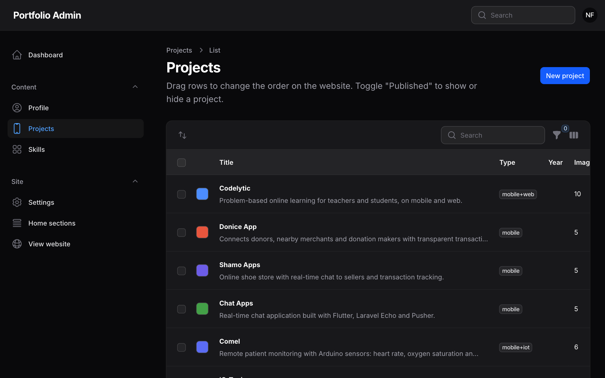
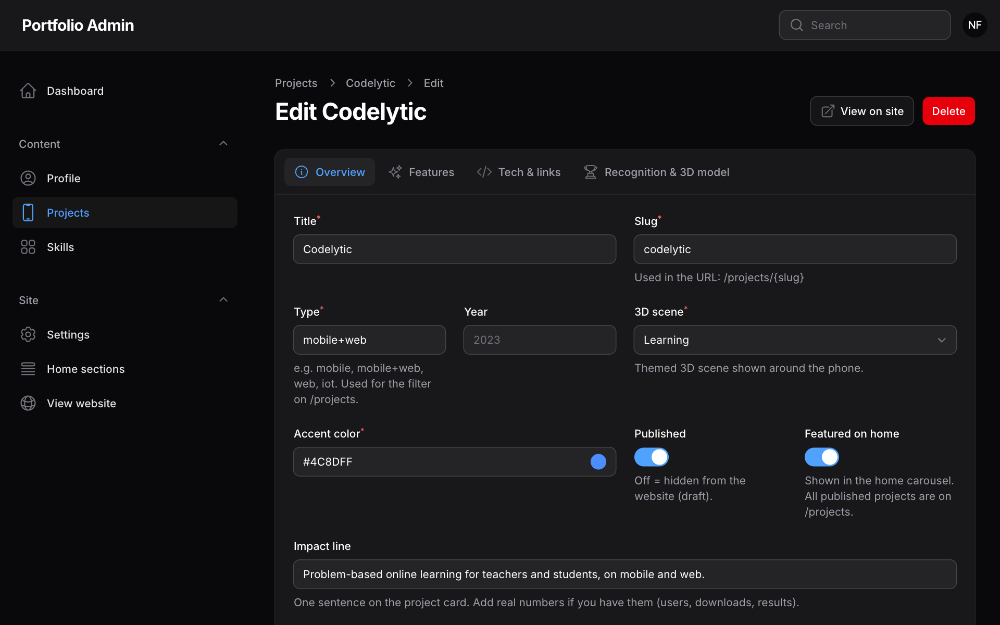
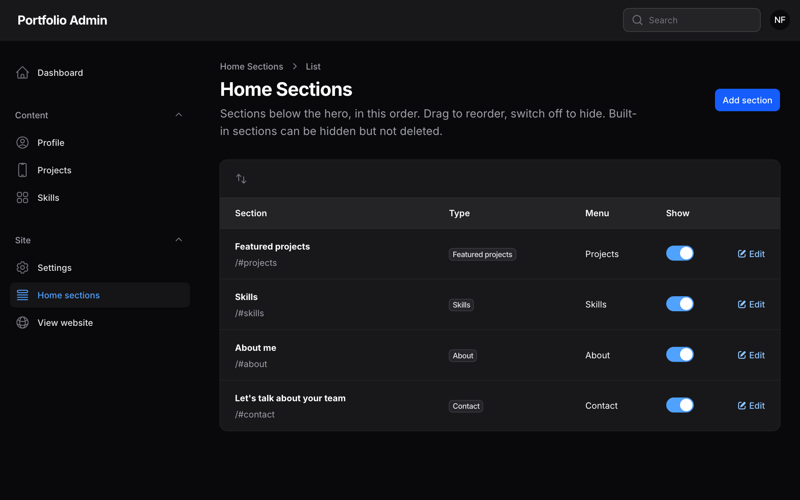

# Panduan Admin

Panduan ini menjelaskan cara mengelola seluruh isi website lewat panel admin, tanpa menyentuh kode. Semua perubahan langsung tampil di website setelah disimpan.



## Daftar isi

1. [Masuk ke admin](#1-masuk-ke-admin)
2. [Dashboard](#2-dashboard)
3. [Profil](#3-profil)
4. [Project](#4-project)
5. [Gambar project](#5-gambar-project)
6. [Skill](#6-skill)
7. [Section beranda](#7-section-beranda)
8. [Pengaturan situs](#8-pengaturan-situs)
9. [Akun dan password](#9-akun-dan-password)
10. [Backup dan pindah database](#10-backup-dan-pindah-database)
11. [Tips dan pertanyaan umum](#11-tips-dan-pertanyaan-umum)

---

## 1. Masuk ke admin

1. Buka `https://domain-anda/admin` (di laptop: `http://127.0.0.1:8000/admin`).
2. Masukkan email dan password admin, lalu klik **Sign in**.
3. Menu ada di sebelah kiri (di HP: tombol ☰ kiri atas):
   - **Content:** Profile, Projects, Skills
   - **Site:** Home sections, Settings, View website

> Tombol **Save changes** juga bisa ditekan dengan `Cmd+S` (Mac) atau `Ctrl+S` (Windows).

## 2. Dashboard

Ringkasan isi website: jumlah project yang dipublikasikan dan yang masih draf, jumlah gambar, dan status CV (**Missing** berarti CV belum diunggah sehingga tombol *Download CV* tidak tampil).

## 3. Profil

Menu **Content → Profile**.

| Bagian | Isi | Catatan |
|---|---|---|
| Hero | Name, Tagline, Bio, Stats | Tagline dipisah dengan tanda `\|`: bagian pertama jadi judul besar (mis. *Mobile App Developer*), sisanya jadi label kecil. Kalimat pertama Bio tampil di bagian atas, Bio lengkap di bagian *About*. Stats maksimal 4 (mis. `4+` / *Years of experience*). |
| Photo & CV | Foto profil, CV (PDF) | Foto otomatis diperkecil dan dikonversi ke WebP. Jika CV kosong, semua tombol *Download CV* otomatis disembunyikan. |
| Contact | Email, Phone, GitHub, LinkedIn | Phone dan LinkedIn yang kosong tidak ditampilkan. |

Klik **Save changes**.

## 4. Project

Menu **Content → Projects**.

### Daftar project
- **Urutan:** tarik (drag) baris untuk mengubah urutan tampil di website.
- **Published:** matikan untuk menyembunyikan project (jadi draf). Project draf tetap bisa Anda lihat saat login, lewat tombol **View**.
- **On home:** project yang menyala tampil di carousel beranda. Semua project yang *Published* tetap ada di halaman **/projects**.
- **Aksi massal:** centang beberapa project → tombol *Bulk actions* → Publish, Hide (draft), Show on home, Remove from home, atau Delete.
- **Filter** (ikon corong): tampilkan hanya yang Published / On home.

### Menambah project baru
Ada dua cara:
- **New project:** isi dari awal.
- **Duplicate:** di baris project yang mirip, klik **⋯ → Duplicate**. Fitur, teknologi dan link ikut tersalin (gambar tidak), dan salinannya tersimpan sebagai draf tersembunyi. Ubah judul dan slug-nya, lalu nyalakan *Published* jika sudah siap.

### Form project (4 tab)



**Overview**
| Kolom | Penjelasan |
|---|---|
| Title / Slug | Slug terisi otomatis dari judul dan menjadi alamat halaman: `/projects/slug`. Hanya huruf kecil, angka dan tanda `-`. |
| Type / Year | Type bebas diisi (saran: `mobile`, `mobile+web`, `web`, `iot`, `game`…). Type dipakai untuk tombol filter di /projects. Year opsional. |
| 3D scene | Tema 3D di sekitar HP. Untuk project yang tidak cocok dengan tema yang ada pilih **Generic** (bentuk melayang) atau **None** (HP saja). |
| Accent color | Warna project (kartu, cahaya halaman, objek 3D). |
| Published / Featured on home | Lihat penjelasan di atas. |
| Impact line | Satu kalimat di kartu project. Tulis hasil nyata jika ada (jumlah pengguna, unduhan, nilai). |
| Short description | Ringkasan. Tampil sebagai *Overview* jika Problem/Solution kosong. |
| Problem / Solution | Opsional. Jika diisi, tampil sebagai dua kartu. |

**Features** – tambah, ubah, urutkan (drag), atau sembunyikan fitur dengan tombol **Show on website**. Kolom *Icon* opsional (nama ikon Heroicons, mis. `heroicon-o-chat-bubble-left-right`); jika kosong, tampil nomor urut.

**Tech & links**
- *Technologies*: satu baris per teknologi, dengan tombol tampil/sembunyi. Logo muncul otomatis untuk teknologi yang dikenal (Flutter, Android, Laravel, Firebase, dll.).
- *Links*: label (mis. *Web*, *Mobile*, *Backend*) dan URL. Jika tidak ada link yang tampil, tombol link disembunyikan.

**Recognition & 3D model**
- *Recognition*: untuk HKI atau penghargaan (Type, Holder, Date). Kosongkan semua jika tidak ada; badge otomatis hilang.
- *GLB model*: model 3D opsional (`.glb`, idealnya < 3 MB). Pada tema *Shoe store* model ini menggantikan sepatu bawaan.

Klik **Save changes**. Tombol **View on site** membuka halaman project di tab baru.

## 5. Gambar project

Di halaman edit project, gulir ke bawah ke bagian **Images**.

- **Add image:** unggah PNG/JPG/WebP (maks. 8 MB), pilih jenisnya, isi caption.
  | Jenis (Kind) | Tampil di |
  |---|---|
  | Phone screenshot | Layar HP 3D + galeri *App screens* |
  | Web / Admin panel | Galeri *Web app* / *Admin panel* |
  | Hardware | Galeri *Hardware* |
  | Certificate | Galeri *Certificates* + tombol *View certificate* di badge HKI |
- **Urutan:** drag baris; screenshot pertama menjadi layar pertama di HP 3D dan gambar di kartu project.
- **Show:** matikan untuk menyembunyikan gambar tanpa menghapusnya.
- Gambar otomatis dikompres ke WebP (ukuran besar dan kecil); file asli tetap disimpan. Mengganti atau menghapus gambar juga menghapus file lamanya.
- Project tanpa screenshot menampilkan layar ilustrasi (nama aplikasi dan grafik bergerak).

## 6. Skill

Menu **Content → Skills**.

- Tiap baris adalah satu grup (mis. *Mobile*, *Architecture*). Drag untuk mengurutkan, tombol **Show** untuk menyembunyikan satu grup.
- Edit grup untuk menambah, mengurutkan atau menyembunyikan skill di dalamnya.
- *Icon* opsional: nama logo dari [simpleicons.org](https://simpleicons.org) (mis. `flutter`, `kotlin`). Banyak logo terdeteksi otomatis dari nama skill.

## 7. Section beranda

Menu **Site → Home sections**. Mengatur bagian-bagian beranda di bawah hero.



- **Urutan:** drag baris. Menu atas website ikut berubah.
- **Show:** sembunyikan section (mis. Skills) tanpa menghapusnya. Section yang disembunyikan juga hilang dari menu.
- **Edit** untuk mengubah:
  - *Title*, *Small label above the title*, *Intro* – kosongkan untuk memakai teks bawaan.
  - *Menu label* – teks di menu atas; kosongkan agar section tidak masuk menu.
  - *Link name* – alamat section, mis. `experience` → `domain/#experience`.
- **Add section** untuk membuat section baru:
  - **Text block** – teks bebas dengan format (tebal, miring, link, judul, daftar).
  - **Timeline** – daftar berurutan seperti **Pengalaman kerja, Pendidikan, Sertifikat, Penghargaan, Organisasi**. Tiap item: Period (mis. `2022 – Present`), Title, Subtitle (perusahaan/sekolah), Description, Link opsional, dan tombol tampil/sembunyi.
- Section bawaan (Featured projects, Skills, About, Contact) bisa disembunyikan tetapi tidak bisa dihapus. Section buatan sendiri bisa dihapus.

## 8. Pengaturan situs

Menu **Site → Settings**.

| Bagian | Isi |
|---|---|
| SEO & sharing | *Site title* (judul di tab browser dan Google), *Meta description* (deskripsi di Google dan saat link dibagikan), *Share image* (gambar saat link dibagikan di WhatsApp/LinkedIn; PNG/JPG 1200×630; jika kosong memakai foto profil). |
| Theme | Warna utama, latar belakang dan teks. Pastikan teks tetap kontras dengan latar. |
| 3D effects | Matikan untuk menampilkan gambar biasa tanpa 3D (berguna untuk HP lama). |

## 9. Akun dan password

Klik avatar di kanan atas → **Profile** (`/admin/profile`) untuk mengganti nama, email atau password akun admin. **Ganti password sementara saat pertama kali login.**

## 10. Backup dan pindah database

Dilakukan lewat Terminal di folder proyek.

**Backup semua isi** (teks, pengaturan, section, project, skill, foto, screenshot, CV, model 3D):
```bash
php artisan portfolio:export
```
Hasilnya ada di `storage/app/exports/<tanggal>/`. Simpan folder itu di tempat aman (mis. Google Drive).

**Mengembalikan backup / memindahkan isi ke server atau database lain:**
```bash
php artisan portfolio:import <folder-backup> --force
```
Perintah ini **mengganti** semua isi dengan isi backup; akun admin tidak berubah.

## 11. Tips dan pertanyaan umum

**Perubahan tidak muncul di website?** Refresh halaman (Cmd+Shift+R). Di server produksi, minta developer menjalankan `php artisan optimize:clear` lalu `php artisan optimize`.

**Ingin menyembunyikan sesuatu sementara?** Gunakan tombol *Published* / *Show* / *Show on website* daripada menghapus.

**Gambar terlalu besar?** Unggah saja; sistem otomatis mengecilkan dan mengompres. Batasnya 8 MB per gambar.

**Teks tombol dan judul bawaan** (mis. *Download CV*, *Key features*) diatur di file `lang/en/site.php`, bukan di admin.

**Sebelum membagikan link** ke recruiter, cek daftar periksa di bagian 6 [README](../README.md#6-before-you-share-the-link-checklist).
