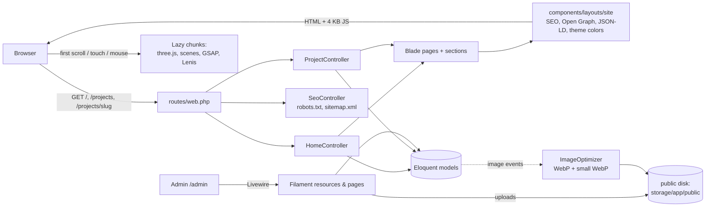

# 1. Architecture

## Goals that shaped the design

- **Recruiter first.** Role, key numbers and the two calls to action (Download CV, Contact Me) are on the first screen; nothing animated blocks reading.
- **Everything editable without code.** All content lives in the database and is managed in a Filament admin panel.
- **Fast on phones.** The site is server-rendered HTML; 3D and animation libraries load only after the first interaction. Lighthouse mobile: performance 98–100, accessibility / best practices / SEO 100.
- **Graceful fallback.** Every 3D element has a static HTML version underneath it.

## Stack

| Layer | Technology |
|---|---|
| Backend | PHP 8.3+, Laravel 13 |
| Admin | Filament 5 (Livewire) |
| Views | Blade components, Tailwind CSS 4 |
| Build | Vite 8 (`laravel-vite-plugin`, self-hosted fonts via `@fonts`) |
| 3D | Three.js (+ `GLTFLoader` for optional `.glb` models) |
| Motion | GSAP + ScrollTrigger, Lenis smooth scrolling |
| Icons | Heroicons (Blade), simple-icons (copied to `public/icons/simple` at build) |
| Database | SQLite or MySQL 8 / MariaDB (PostgreSQL also supported) |
| Images | GD: original + WebP (max 1600 px) + small WebP (560 px wide) |
| AI chatbot | Laravel AI SDK (`laravel/ai`) + Google Gemini (free tier) |

## Request flow



- Public pages are plain controllers returning Blade views. There is no API and no client-side routing.
- Shared data for the layout (settings, profile, sections) comes from `App\Support\Site`, a per-request (scoped) service, injected into the layout with a view composer in `AppServiceProvider`.
- The admin panel (`/admin`) is a Filament panel defined in `app/Providers/Filament/AdminPanelProvider.php`.

## Folder structure

```
app/
  Ai/Agents/             PortfolioAssistant (AI chatbot agent)
  Console/Commands/      portfolio:export, portfolio:import, portfolio:images
  Filament/              Admin: Resources (Projects, SkillGroups, PageSections), Pages (Profile, Settings), Widgets
  Http/Controllers/      HomeController, ProjectController, SeoController, ChatController
  Models/                Eloquent models + Concerns (HasVisibility, OptimizesImages)
  Providers/             AppServiceProvider (Site service, view composer, chat rate limit), Filament panel provider
  Services/              ImageOptimizer (GD → WebP), PortfolioContext (portfolio text for the AI)
  Support/               Site (per-request data), Icon (simple-icons), Img (srcset helpers)
data/content.json        Initial content (first import)
seed/                    Initial images and files referenced by content.json
database/
  migrations/            Schema (2 portfolio migrations)
  seeders/               DatabaseSeeder (admin user, guard), PortfolioSeeder (import)
deploy/nginx.conf        Example production web server config
docs/                    This documentation
lang/en/site.php         Interface text (translatable)
public/.htaccess         Apache: rewrite + gzip + cache headers
resources/
  css/app.css            Tailwind theme tokens, phone frame, 3D/motion styles
  js/app.js              Entry point
  js/ui/                 Small UI modules (nav, rails, lightbox, carousel, filter, chat, motion, 3D boot)
  js/three/              PhoneViewer3D, phone model, screen textures, helpers
  js/scenes/             One module per accent scene + hero particles
  views/                 Layout, components, sections, pages, errors, seo
scripts/copy-icons.mjs   Copies simple-icons SVGs into public/icons/simple
tests/Feature/           Feature tests (PHPUnit)
```

## Key design decisions

| Decision | Why |
|---|---|
| Server-rendered Blade, no SPA | Fast first paint, SEO, works without JavaScript. |
| Static phone first, 3D on first interaction | Keeps Lighthouse mobile above 85 (Three.js is ~150 KB gzip and costly to parse on slow phones). |
| `is_visible` instead of deleting | The owner can hide items temporarily without losing them. |
| Home sections in the database (`page_sections`) | Order, visibility, titles and custom Text/Timeline sections are editable without code. |
| Original + WebP + small WebP for every image | Originals are kept for future re-processing; visitors get small files through `srcset`. |
| Export/import as JSON + files | Database-agnostic backup and an easy way to move from SQLite to MySQL. |
| Seeder never overwrites existing content | Running `db:seed` on a live site can't wipe edits (`SEED_FORCE=true` to force). |
| Interface text in `lang/en/site.php` | Adding a language means copying one file. |
