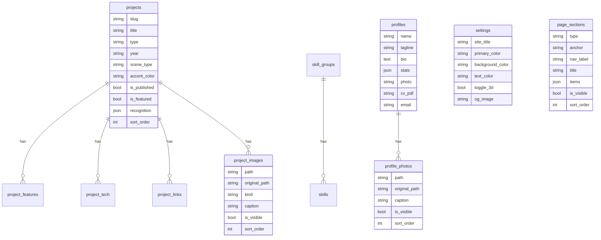

# 2. Data model

All content is stored in eleven tables (plus Laravel's own `users`, `sessions`, `cache`, `jobs`, `migrations`). Schema: `database/migrations/2026_10_24_000001_create_portfolio_tables.php` `2026_10_25_000001_add_visibility_and_page_sections.php` and `2026_10_26_113637_create_profile_photos_table.php`. Everything works the same on SQLite, MySQL/MariaDB and PostgreSQL.

## Tables

### `profiles` (single row) – `App\Models\Profile`
| Column | Notes |
|---|---|
| `name`, `tagline`, `bio` | Hero and About. The tagline is split at `\|`: first part = headline, rest = tags. |
| `stats` | JSON array `[{label, value}]`, max 4 in the admin. |
| `photo`, `photo_original` | Display WebP and the uploaded original. |
| `cv_pdf` | Nullable. No file = no "Download CV" buttons (`Profile::cvUrl()`). |
| `email`, `github`, `linkedin`, `phone` | Empty LinkedIn / phone are hidden on the site. |

### `profile_photos` – `App\Models\ProfilePhoto`
Personal gallery in the About section (`Profile::photos()`, ordered by `sort_order`). Columns: `path` + `original_path` (auto WebP via `OptimizesImages`), `caption`, `width`, `height`, `is_visible`, `sort_order`. Deleting the profile deletes the photos and their files. No visible photo = About shows the single profile `photo`.

### `settings` (single row) – `App\Models\Setting`
`site_title`, `meta_description`, `primary_color`, `background_color`, `text_color` (become CSS variables), `toggle_3d` (exposed as `<html data-3d="on|off">`), `og_image` (share image, kept as PNG/JPG).

### `projects` – `App\Models\Project`
| Column | Notes |
|---|---|
| `slug` | Unique, used in `/projects/{slug}` (route key). |
| `title`, `short_description`, `impact_line`, `problem`, `solution` | Texts. `problem`/`solution` are optional. |
| `type`, `year` | Free text. `type` drives the filter on `/projects`; known types are translated in `lang/en/site.php`, others are title-cased (`Project::typeLabel()`). |
| `accent_color` | `#RRGGBB`, used for cards, page glow and the 3D scene. |
| `scene_type` | `learning`, `donation`, `shoe-store`, `chat`, `health-iot`, `hydroponic`, `analytics`, `generic` or `none` (`Project::SCENE_TYPES`). |
| `model_glb` | Optional uploaded `.glb` path. |
| `recognition` | JSON `{type, holder, published}` or null. Shows the HKI badge. |
| `is_published` | Draft/published. Drafts are 404 for visitors, visible to a logged-in admin. |
| `is_featured` | Shown in the home carousel. If no project is featured, all published ones are shown. |
| `sort_order` | Drag order in the admin. |

### Project children
| Table | Columns | Model |
|---|---|---|
| `project_features` | `title`, `description`, `icon` (optional Blade icon name) | `ProjectFeature` |
| `project_tech` | `name` | `ProjectTech` |
| `project_links` | `label`, `url` | `ProjectLink` |
| `project_images` | `path` (WebP), `original_path`, `kind` (`screenshot`, `web`, `admin`, `hardware`, `certificate`), `caption`, `width`, `height` | `ProjectImage` |

All four have `is_visible` and `sort_order`, and are deleted with their project (`cascadeOnDelete`; images are deleted through the model so files are removed too).

### `skill_groups` and `skills`
`SkillGroup` (`name`) has many `Skill` (`name`, `icon` = optional simple-icons slug). Both have `is_visible` and `sort_order`.

### `page_sections` – `App\Models\PageSection`
Sections of the home page below the hero.

| Column | Notes |
|---|---|
| `type` | Built-in: `projects`, `skills`, `about`, `contact` (cannot be deleted). Custom: `text`, `timeline`. |
| `anchor` | Unique; the `#id` of the section and the menu link. |
| `nav_label` | Menu label; empty = not in the menu. |
| `eyebrow`, `title`, `intro` | Empty values on built-in sections fall back to `lang/en/site.php` (`PageSection::text()`). |
| `body` | Rich text for `text` sections (sanitized on output). |
| `items` | JSON for `timeline` sections: `[{period, title, subtitle, description, url, link_label, is_visible}]`. A multi-line `description` renders as a bullet list (one point per line; leading `-`, `•` or `*` is stripped). |
| `is_visible`, `sort_order` | Visibility and order on the page and in the menu. |

The four built-in rows are inserted by the second migration.

## Rules used everywhere

- **Visibility:** child models use the `HasVisibility` trait (`is_visible` cast + `visible()` scope). Public controllers load relations with `->visible()` constraints; the admin always sees everything.
- **Ordering:** every list uses `sort_order`; relations are defined with `orderBy('sort_order')`.
- **Images:** `ProjectImage` and `Profile` use the `OptimizesImages` trait. Saving a new non-WebP file stores the upload as the original and creates `name.webp` + `name-sm.webp`; replacing or deleting removes old files.
