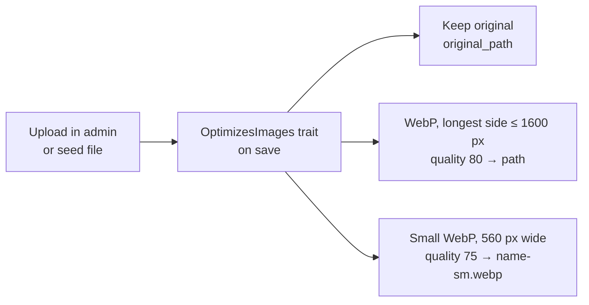

# 3. Backend

## Routes (`routes/web.php`)

| Route | Controller | View |
|---|---|---|
| `GET /` | `HomeController` | `pages/home` |
| `GET /projects` | `ProjectController@index` | `pages/projects` |
| `GET /projects/{project:slug}` | `ProjectController@show` | `pages/project` |
| `GET /robots.txt` | `SeoController@robots` | text |
| `GET /sitemap.xml` | `SeoController@sitemap` | `seo/sitemap` |
| `/admin/*` | Filament panel | – |

## Controllers

- **`HomeController`** loads published projects with `Project::publicRelations()` (visible screenshots, certificates and tech), picks the featured ones for the carousel (falls back to all published), visible skill groups with visible skills, and the visible sections from `Site`.
- **`ProjectController@index`** lists all published projects and the distinct types for the filter chips.
- **`ProjectController@show`** returns 404 for drafts unless a user is logged in (preview), loads only visible links/features/tech/images, and finds the previous/next published project.
- **`SeoController`** generates `robots.txt` (disallows `/admin`, points to the sitemap) and `sitemap.xml` with the live domain.

## Support classes (`app/Support`)

| Class | Purpose |
|---|---|
| `Site` | Scoped (per request) service: `settings()`, `profile()`, `sections()`, `nav()`, `defaultOgImage()`. The layout gets these through a view composer registered in `AppServiceProvider`. |
| `Icon` | Inline simple-icons SVGs by slug. `slugFor($name, $explicit)` tries the explicit slug, an alias table, then the slugified name. Icons are read from `public/icons/simple` (copied by `scripts/copy-icons.mjs` during `npm run build`). |
| `Img` | `srcset($path, $width)` → `"x-sm.webp 560w, x.webp 1600w"`, `small($path)` for tiny images. |

## Image pipeline (`app/Services/ImageOptimizer.php`)



- GD only (no Imagick needed).
- `store($source, $dir)` is used by the seeder; `convertStored($path)` by the model trait for admin uploads.
- `php artisan portfolio:images` regenerates every small variant (safe to run any time).
- The share image (`settings.og_image`) is not converted because some social networks don't show WebP previews.

## Seeding and content import

- **`DatabaseSeeder`**: creates the admin user once (`ADMIN_EMAIL`, `ADMIN_PASSWORD`; a random password is printed when none is set) and runs `PortfolioSeeder` **only if there are no projects yet** (or `SEED_FORCE=true`).
- **`PortfolioSeeder`**: replaces all content from `content.json` and the files next to it. It reads `data/content.json` + `seed/` by default, or any folder via its `$root` property. All fields beyond the first version of the format are optional.

### `content.json` format (version 2)

```jsonc
{
  "version": 2,
  "profile":  { "name": "...", "tagline": "...", "bio": "...", "stats": [{"label": "...", "value": "..."}],
                "email": "...", "github": "...", "linkedin": null, "phone": null,
                "photo": "files/profile/photo.jpg", "cv_pdf": "files/profile/cv.pdf" },
  "settings": { "site_title": "...", "primary_color": "#4C8DFF", "toggle_3d": true, "og_image": null },
  "sections": [{ "type": "timeline", "anchor": "experience", "nav_label": "Experience", "title": "...",
                 "items": [{ "period": "2023", "title": "...", "is_visible": true }], "is_visible": true, "order": 5 }],
  "projects": [{ "slug": "codelytic", "title": "...", "type": "mobile+web", "year": "2023", "order": 1,
                 "is_published": true, "is_featured": true, "scene_type": "learning", "accent_color": "#4C8DFF",
                 "impact_line": "...", "short_description": "...", "problem": null, "solution": null,
                 "recognition": null, "model_glb": null,
                 "features": [{ "title": "...", "description": "...", "icon": null, "is_visible": true }],
                 "tech":     ["Flutter", { "name": "Bloc", "is_visible": true }],
                 "links":    [{ "label": "Web", "url": "https://...", "is_visible": true }],
                 "images":   [{ "file": "seed/codelytic/01_screenshot.png", "kind": "screenshot", "caption": "Login" }] }],
  "skills":   [{ "group": "Mobile", "items": ["Flutter", { "name": "Android", "icon": "android", "is_visible": true }] }]
}
```

File paths are relative to the folder that contains `content.json`.

## Artisan commands (`app/Console/Commands`)

| Command | What it does |
|---|---|
| `portfolio:export {path?}` | Writes `content.json` (version 2) and copies all original files into a folder (default `storage/app/exports/<date>`). |
| `portfolio:import {path?} {--force}` | Replaces all content with an export folder (default: `data/` + `seed/`). Admin users are kept. Runs `portfolio:images` afterwards. |
| `portfolio:images` | Rebuilds the small WebP variants. |

## Security notes

- Only users in the `users` table can enter `/admin` (`User::canAccessPanel()`); there is no public registration.
- Rich text from text sections is sanitized with `sanitizeHtml()` before output.
- Uploads go to the `public` disk with type and size limits (images ≤ 8 MB, `.glb` ≤ 20 MB, PDF ≤ 10 MB).
- `robots.txt` disallows `/admin`. Production must run with `APP_DEBUG=false`.
