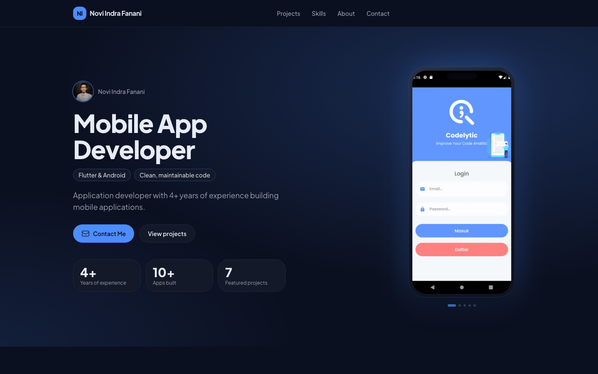
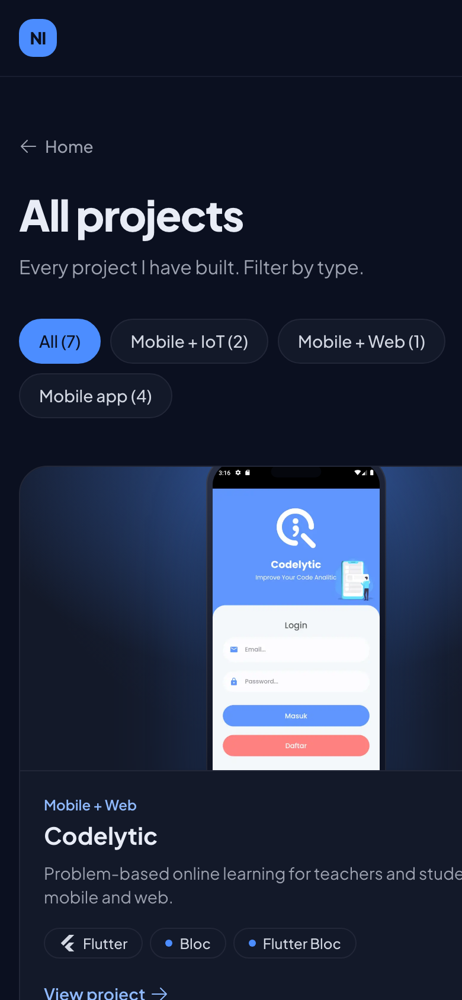
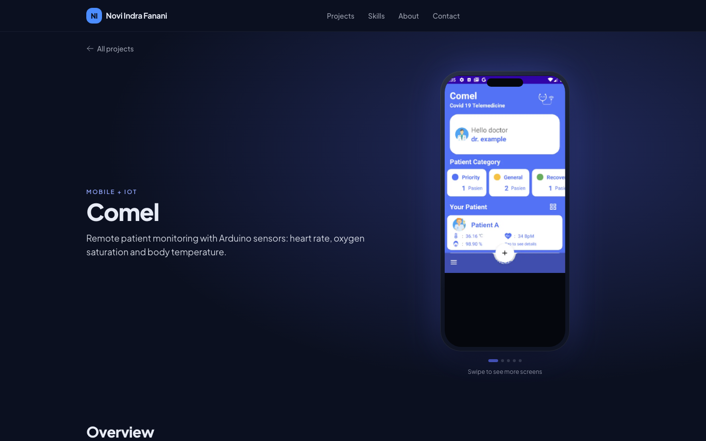

# User guide (website visitors)

This guide explains how to use the portfolio website. It works on phones, tablets and computers in any modern browser.

## The home page

From top to bottom (the owner can change the order and hide sections):

1. **Hero** – name, role, highlights, key numbers and the main buttons:
   - **Download CV** (shown when a CV is available) downloads the PDF.
   - **Contact Me** jumps to the contact details.
   - **View projects** jumps to the projects.
2. **Featured projects** – a carousel of project cards.
3. **Skills** – grouped skills with technology logos.
4. **About** – photo and short biography.
5. **Contact** – email, GitHub and (when available) LinkedIn and phone.

Other sections such as *Experience* or *Education* may appear when the owner adds them. The top menu links to each section; on phones open it with the ☰ button.

- **"Now showing"** under the hero phone names the app on screen; click it to open that project.
- On phones, **Download CV** and **Contact Me** stay at the bottom of the screen after the first screen.
- **Skills:** click a highlighted skill (e.g. *Flutter*) to list the projects that use it; they are also highlighted in the carousel.
- **Contact:** the clipboard button next to the email copies the address.

## Browsing projects

- **Carousel:** swipe left/right on a phone, or drag with the mouse / use the ← → buttons on a computer. Click a card to open the project.
- **All projects:** the "See all projects" button (or `/projects`) lists every project. Use the filter buttons (e.g. *Mobile app*, *Mobile + IoT*) to narrow the list.

## A project page

A bar under the menu jumps to *Overview, Key features, Tech stack, Links, Gallery* and shows where you are. On a computer, hovering a project card plays a few of its screens.

- **Header:** project type and year, the impact line, a badge for registered software copyright (HKI) when available, and buttons to the live app or source code.
- **3D phone:** shows the app's real screens.
  | Action | Phone / tablet | Computer |
  |---|---|---|
  | Rotate the phone | Drag | Drag with the mouse |
  | Next / previous screen | Quick swipe left / right | Quick drag, or ← → keys after clicking the phone |
  | Zoom | Pinch with two fingers | Pinch on the trackpad, or `+` / `-` |
  | Tilt | Tilt your device (Android) | Move the mouse over the phone |

  The objects around the phone are an illustration of the project's theme (some are interactive, e.g. the quiz cube on Codelytic can be clicked).
- Features with a **See this screen** button switch the phone to that screen.
- **Overview, Key features, Tech stack, Links** – what the app does and how it was built.
- **Gallery** – screenshots, web pages, admin panels, hardware and certificates. Click an image to open it full screen:
  - swipe or ← → to move between images,
  - pinch, double-tap/double-click or use the mouse wheel to zoom, drag to move a zoomed image,
  - `Esc`, the ✕ button or a click outside the image closes it.
- **Previous / Next project** at the bottom.

## Ask about me (AI assistant)

The **Ask about me** button in the bottom-right corner opens a chat. Ask anything about the owner's projects, skills or experience, in English or Indonesian, or tap one of the suggested questions.

- Answers come from the content of this website only. If something isn't covered (for example salary expectations), the assistant says so and points you to the email address.
- Project names in answers link to their project pages.
- It remembers the last few messages, so follow-up questions like "which technologies did that project use?" work.
- Answers are generated by AI and may contain mistakes; the project pages are the source of truth.
- Please don't enter personal data. There is a limit on questions per hour.

## Good to know

- **The 3D appears after your first scroll or touch.** Until then you see the same phone as a normal image; this keeps the page fast on mobile data.
- **Reduced motion:** if your device has "Reduce motion" turned on, the site does not animate on its own (no auto-rotation, smooth scrolling or page transitions). Everything stays usable.
- **No 3D?** Older devices, data-saver mode or browsers without WebGL show static images instead; all content is the same.
- **Keyboard:** use `Tab` to move between links and buttons; a "Skip to content" link appears first.
- **Sharing:** links to the home page and to each project show a title, description and image in WhatsApp, LinkedIn and other apps.
